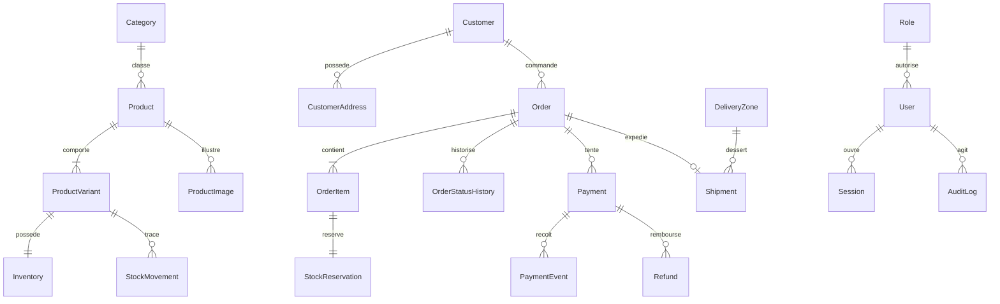

# Modèle relationnel conceptuel

Proposition, à traduire en Prisma seulement en Phase 2. Identifiants internes opaques ; montants entiers XOF bornés ; dates UTC. Les valeurs monétaires historiques ne sont jamais recalculées depuis le catalogue.

| Entité             | Champs clés et relations                                                                                                                                             | Contraintes/index                                                                         |
| ------------------ | -------------------------------------------------------------------------------------------------------------------------------------------------------------------- | ----------------------------------------------------------------------------------------- |
| Category           | id, name, slug, active                                                                                                                                               | slug unique                                                                               |
| Product            | categoryId, name, slug, description, status, archivedAt                                                                                                              | slug unique ; index catégorie/statut                                                      |
| ProductVariant     | productId, sku, label, attributes JSON, priceXof, active                                                                                                             | SKU unique ; prix ≥ 0 ; index productId                                                   |
| ProductImage       | productId, variantId facultatif, objectKey, alt, position                                                                                                            | variante appartenant au même produit ; index produit/position                             |
| Inventory          | variantId, onHand, reserved, version                                                                                                                                 | variante unique ; 0 ≤ reserved ≤ onHand                                                   |
| StockReservation   | orderItemId, quantity, status, expiresAt                                                                                                                             | ligne unique ; quantité > 0 ; index statut/expiration                                     |
| StockMovement      | variantId, orderItemId facultatif, type, quantity, reason, actorId, operationKey                                                                                     | clé opération unique ; historique immuable ; index variante/date                          |
| Customer           | id, name, phoneNormalized                                                                                                                                            | téléphone indexé, non unique ; aucun compte public                                        |
| CustomerAddress    | customerId, zoneId facultatif, district, address, instructions                                                                                                       | index customerId ; pas de suppression en cascade des commandes                            |
| Order              | customerId, reference, status, currency, subtotalXof, deliveryXof, totalXof, addressSnapshot, contactSnapshot, idempotencyKey, requestHash, accessTokenHash, version | référence/clé uniques ; total = sous-total + livraison ; index statut/date et client/date |
| OrderItem          | orderId, variantId, nameSnapshot, skuSnapshot, attributesSnapshot, unitPriceXof, quantity, lineTotalXof                                                              | quantité > 0 ; total ligne = prix × quantité ; index orderId                              |
| OrderStatusHistory | orderId, fromStatus, toStatus, actorId, reason, createdAt                                                                                                            | ajout seul ; index commande/date                                                          |
| Payment            | orderId, provider, status, amountXof, providerReference, idempotencyKey, failureCode                                                                                 | référence unique par fournisseur si présente ; clé unique ; index commande/statut         |
| PaymentEvent       | paymentId facultatif, provider, providerEventId, type, processingStatus, receivedAt, processedAt                                                                     | fournisseur/événement unique ; événements non rapprochés conservés pour reprise           |
| Refund             | paymentId, amountXof, status, externalReference, operationKey, actorId, reason                                                                                       | clé unique ; somme remboursée ≤ encaissé ; index paymentId                                |
| DeliveryZone       | name, feeXof, active                                                                                                                                                 | frais ≥ 0                                                                                 |
| Shipment           | orderId, zoneId, status, deliveryFeeSnapshot, addressSnapshot, dispatchedAt, deliveredAt                                                                             | orderId unique en V1                                                                      |
| Role               | code                                                                                                                                                                 | codes OWNER et MANAGER uniques                                                            |
| User               | email, roleId, active, identité selon solution auth                                                                                                                  | email normalisé unique                                                                    |
| Session            | userId, tokenHash, expiresAt, revokedAt                                                                                                                              | token haché unique ; index expiration                                                     |
| StoreSettings      | singleton, name, contacts, socialLinks, version                                                                                                                      | secrets exclus ; version pour concurrence                                                 |
| AuditLog           | actorId, action, targetType, targetId, safeDiff, operationKey, createdAt                                                                                             | index cible/date et acteur/date ; ajout seul                                              |

`Refund` est nécessaire au suivi minimal des remboursements, même lorsque l'exécution financière est manuelle. Aucun module complet de gestion des retours n'est prévu.

Les comptes externes et jetons de récupération éventuellement nécessaires à l'authentification seront ajoutés selon la bibliothèque choisie, pas improvisés dans Session.

## Intégrité

- Clés étrangères obligatoires pour les relations requises ; interdiction de cascade supprimant ventes, paiements ou historique.
- Produit archivé conservé pour l'historique ; snapshot reste lisible même si sa présentation change.
- Vérifications SQL CHECK pour montants, quantités et cohérence Inventory ; contraintes inter-lignes appliquées par services transactionnels et tests.
- Réservation : mise à jour conditionnelle `onHand - reserved >= quantité`, avec ordre de verrouillage stable par variante ; rollback intégral si une ligne échoue.
- Version optimiste sur transitions et paramètres ; conflit rendu explicitement au gestionnaire.
- Plusieurs tentatives Payment possibles, mais pas de deuxième tentative active volontairement ; un double encaissement externe est une anomalie à rapprocher/rembourser, pas une seconde commande.
- Événements externes stockés sous forme minimale, sans secrets ; politique de rétention à fixer. Pas de copie illimitée de payloads contenant des données personnelles.
- Téléphone normalisé ; aucun accès à l'historique d'une personne accordé sur la seule connaissance de son numéro.

## Relations principales

